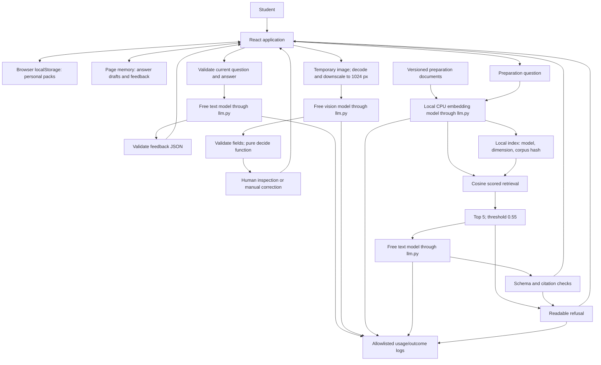

# InterviewCoach · Design Review

20 October 2026 · shared local prototype · team review/submission pending.
This review describes implemented behavior and agent-run evidence. It does not
claim that the branch has been merged, tagged, or independently reviewed.

## 1. Problem, users and success criteria

Students and recent graduates preparing for entry-level interviews need relevant
questions, specific feedback on truthful examples, and preparation guidance they
can inspect. InterviewCoach connects role packs, written practice, job-advert
extraction and sourced guidance. It does not make hiring decisions.

The [shared specification](spec.md) defines four checkable criteria:

| Criterion | Current evidence |
|---|---|
| Practise a selected/custom question; validate input; preserve drafts through navigation and provider errors | [API safety tests](../project/tests/test_safety.py), [browser verification](verification.md), [live feedback](evidence/live-feedback.json) |
| Downscale images, validate extraction, leave unsupported required fields empty and require human review | [extraction/policy code](../project/backend/app/extraction.py), [confidence policy](confidence-policy.md), [four live fixtures](evidence/images-20261020T193252Z.json) |
| Retrieve scored passages, refuse below threshold before generation, and reject invalid citations | [grounding code/tests](../project/backend/app/grounding.py), [golden result](../evals/results/20261020T193257001485Z.json) |
| Record real usage/latency without private inputs; enforce free-only access | [gateway](../project/backend/app/llm.py), [sanitized logs](../logs/verified-usage.jsonl), [budget](../logs/budget-summary.json) |

The live golden target is not fully met (4/5); the proposed 9/10 requests within
15 seconds has not been demonstrated by a ten-trial study.

## 2. Architecture and data flow

Starter packs come from [versioned content](../project/backend/app/content.py).
Custom pack/question text is untrusted; the server validates the current question
and answer rather than trusting a homework-only question ID. Feedback assesses
the answer against a fixed rubric, with no promise of hiring success.

Images are JPEG/PNG under 2 MB, decoded and downsized before external processing.
The [confidence policy](confidence-policy.md) combines required-field presence,
evidence/value consistency, ambiguity and model confidence. Doubtful values remain
empty; the student supplies corrections explicitly. Images/answers are not saved
in an application store; page drafts disappear on session end/reload.

[Ten AI-assisted team-authored guides](../data/corpus/) are embedded locally with
BAAI/bge-small-en-v1.5. This differs from the lab's hosted embedding example and
is documented in [ADR 002](decisions/002-free-local-embeddings.md). A missing,
changed-corpus or wrong-model index refuses to load. Retrieval sends only accepted
passages to generation. Checked `[n]` markers map to expandable document excerpts.

## 3. Risks and safety threats

| Product risk | Existing mitigation; remaining work | Owner |
|---|---|---|
| Invented or misplaced coaching | Fixed rubric, validated labels, no hiring guarantees; first live response swapped praise/criticism, preserved as [evidence](evidence/live-feedback-initial.json); clearer instructions improved the retest. Human quality review due 21 Oct. | Anastasia |
| Unsupported preparation advice | Threshold refusal, grounded flag and citation checks; current answerable-case false refusal retained. Citation existence cannot prove semantic support. Expand support checks by 27 Oct. | Anastasia |
| Wrong advert role/skills | Nullable evidence, substring consistency, ambiguity checks, empty doubtful fields and explicit confirmation. Model-provided evidence is not independent OCR proof. Test real photos by 27 Oct. | Nikoloz |
| Private answers/images reaching a provider | UI disclosure/acknowledgment, temporary processing, no private input logging, ignored local key. Provider retention remains outside our control. Review disclosure before team use, 21 Oct. | Luka |
| Prompt injection in questions, answers or images | Untrusted content separated from trusted instructions, narrow schemas, plain-text rendering. Message separation is tested; live adversarial resistance is not proven. Add attack cases by 27 Oct. | Luka |
| Provider failure, quota or unexpected spend | Verified zero-price `:free` model, no paid fallback/retry, timeout, per-process call cap, preserved drafts. Free availability is not guaranteed. | Luka |
| Lost local packs or weak source material | Browser-only storage disclosed; versioned corpus labeled AI-assisted/review pending. Review guides and define export/storage needs by 27 Oct. | Nikoloz |

Dates above are proposed follow-up commitments requiring team confirmation, not
claims of completed teammate work.

## 4. Evaluation plan

[Golden definition](../evals/golden.yaml): two factual, one two-source reasoning,
one typo edge case and one refusal. The [same-service runner](../evals/run_golden.py)
calls the function used by the API. [Baseline](../evals/results/20261020T193019665098Z.json):
**2/5**. [Selected run](../evals/results/20261020T193257001485Z.json): **4/5 (80%)**.
The truthful-achievements question still refuses due to invalid citations or
grounded=false despite relevant source material; it remains FAIL.

[ADR 003](decisions/003-retrieval-tuning.md) records k=3 to k=5: the required second
reasoning source ranked fourth. Optional reasoning and valid citation-punctuation
handling also changed, so the improvement is not attributed solely to k.
Threshold 0.55 blocks the unrelated question (best score 0.500) before generation.
Bad citations and uncited sentences block display. Offline tests enforce those
rules. The latest image run passed 4/4 synthetic routes; earlier truncations remain.

By Week 11: ten cases (3 factual, 2 reasoning, 2 edge, 2 refusal, 1 format), with
human source-support review. Proposed release gate: >=8/10 overall, both refusal
cases pass, and zero known invalid-citation displays or automatic paid calls.
Safety-test failure blocks release regardless of aggregate score.

## 5. Token budget

From [real usage logs](../logs/verified-usage.jsonl) and [summary](../logs/budget-summary.json):

| Operation/sample | Mean input/output tokens | Mean model latency | Reported cost/request |
|---|---:|---:|---:|
| Feedback, latest browser request (n=1) | 234 / 153 | 5.094 s | $0 |
| Latest golden generations (n=4) | 821.75 / 82 | 3.162 s | $0 |
| Completed extraction requests (n=5) | 1042.4 / 87.2 | 2.106 s | $0 |

These small samples do not establish a service-level guarantee. Guidance includes
one validated model reply that the application refused. Earlier provider/model
failures remain in the logs; local embeddings consume no provider tokens.

Assume 20 users/month, each making 10 feedback requests, 10 guidance requests and
one image import: **20 × (10 + 10 + 1) = 420 requests/month**. At the observed
zero provider prices: **20 × (10×$0 + 10×$0 + $0) = $0/month**. Hosting,
hardware/electricity and guaranteed free capacity are excluded.

RAG versus long context: [local counts](evidence/context-comparison.json) for the
STAR question are 677 retrieved-context versus 1,311 full-corpus BGE tokens:
**1 − 677/1,311 = 48.36% less passage text**. These are local-tokenizer proxy
counts, not measured generation-provider long-context usage. No full corpus was
uploaded. At current free prices either has zero token charges; we choose RAG
for bounded sources and pre-generation refusal, accepting local index complexity.

## 6. Team, roles and decisions

[TEAM-CONTRACT.md](../TEAM-CONTRACT.md) names Anastasia Khevtsuriani, Luka Khutsidze
and Nikoloz Babunashvili. Luka's personal signature is still listed as pending;
no signature was fabricated. [TEAM-REPO section 1](TEAM-REPO.md#1-members-and-roles)
records specification/evaluation, repository/integration and shared-app roles.

Decisions: [stack/storage](decisions/001-shared-app-stack.md),
[free local embeddings](decisions/002-free-local-embeddings.md), and
[retrieval tuning](decisions/003-retrieval-tuning.md).
[Delegation log](delegation-log.md) identifies agent implementation and drafting,
including this review. Teammate code/document review, remote CI, merge to main,
appropriate lab/review tags and the repo keeper's team form remain required.
